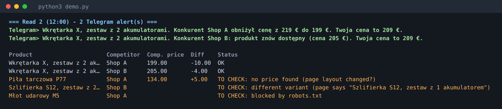

# PriceGuard

Watches prices and stock on web shops and sends a Telegram message when it
matters. Two ways to use it: a **control panel** for a shopper hunting deals, and a
**competitor monitor** for a shop owner. When it is *not sure*, it says so instead of guessing.



## Control panel (dashboard)

For a shopper hunting a phone, shoes, a PS5, a monitor or a TV: one local web page with two modes.

```
python3 -m priceguard serve --lang pl --interval 120 --rates "USD=0.9,PLN=0.23"   # open http://127.0.0.1:8765
python3 demo_dashboard.py --serve                                                 # same panel with fake demo data
```

- **Search now (nothing saved):** pick the product, where it should be delivered, and the markets
  (PL, DE, NL, CZ, AT, USA, China, UK, Switzerland). Each market comes with a ready list of shops and a
  search link per shop. Paste the product links you found and get a comparison sorted by **estimated total cost**.
- **Wish list (saved):** the same choices stay attached to the item (destination, markets, target price, links).
  The system re-checks the prices every N minutes or on a button, keeps the history and sends Telegram alerts.
- **Total cost estimate:** price + shipping + VAT/duty by route: same country (shipping only), inside the EU
  (VAT of the destination country), outside the EU (shipping, optional duty %, import VAT). Exchange rates,
  shipping and duty are assumptions you can override; it is an orientation, not a shop offer.
- The target price is compared with the total cost in the destination currency.
- Per item: best price now, lowest seen, price chart per shop, target reached, rows to check.
- Alerts for drops, back in stock and target reached (`TELEGRAM_BOT_TOKEN` and `--telegram-chat`).
- Listens on `127.0.0.1` only; forms carry a random token; all text is HTML-escaped.
- The shop lists per country are written from general knowledge and are **not verified** against live sites:
  test each shop in the panel ("OK" or "to check").

## The problem (shop owner mode)

A shop owner checks the prices of a few dozen competitor products by hand every
day. It costs an hour a day and still misses price drops.

## What it does

1. **Product list.** The owner keeps a sheet (here a CSV; the same columns work
   in Google Sheets): own SKU, own price, currency, the variant that must match,
   the competitor's product URL, and optionally a **target price** and the **EAN**.
2. **Reads each page** every few hours: price, currency, stock, shipping if the
   page shows it. It uses the structured data shops publish for Google
   (schema.org JSON-LD, then microdata). It never guesses a price from loose page text.
3. **Compares only like with like.** A page with a different variant
   ("1 battery" instead of "2 batteries"), another currency, or **another EAN/GTIN**
   (same model name, different product) is *not* compared. It is shown as `TO CHECK`.
   If the page publishes no GTIN, nothing is claimed either way.
4. **Keeps the history** in SQLite and writes a status sheet (`status.csv`), `price_history.csv`
   and an **HTML report** (`report.html`: price chart per product, rows to check
   highlighted). A failed read never overwrites the last known price; the row keeps
   it and is marked `TO CHECK: <reason>`.
5. **Alerts on Telegram** (pl / de / en):
   - a price drop by a chosen percentage:
     *"Wkrętarka X, zestaw z 2 akumulatorami. Konkurent Shop A obniżył cenę z 199 € do 189 €. Twoja cena to 209 €. To najniższa cena z 3 naszych odczytów."*
   - a product back in stock,
   - the price reaching your **target** (fires when it crosses the target, not on every read).
   "Lowest" is said only about what was actually measured: at least 3 readings, and the
   new price strictly below all earlier ones. A shop's own "was 299 €" is never trusted.
6. **Polite by design:** checks `robots.txt` (a URL it disallows is skipped and
   flagged, and an unreadable robots.txt means *skip*), pauses between requests
   to one host, retries 429/5xx a bounded number of times, identifies itself.
7. **Alerts survive outages.** They go into an outbox and are marked sent only
   after Telegram accepted them, so an outage re-sends later instead of losing
   them. In the rare crash between sending and marking you may get one
   duplicate; for price alerts that is the right trade.

## Run it (offline, nothing leaves your machine)

Python 3.9+, standard library only. On Windows also run `pip install tzdata`.

```
python3 demo.py                         # fake shop on localhost, read three times; writes demo_report.html
python3 demo_dashboard.py --serve       # the control panel with demo data
python3 -m unittest discover -s tests   # 42 tests
```

Against real pages (every few hours via cron or Windows Task Scheduler):

```
export TELEGRAM_BOT_TOKEN=...
python3 -m priceguard run --products my_products.csv --telegram-chat 123456 --threshold 5 --lang pl
```

CSV columns: `sku,name,my_price,currency,variant,competitor,url` and optionally `target_price,ean`
(older files without the last two keep working).

## Layout

| Path | Purpose |
| --- | --- |
| `priceguard/parse.py` | Price, currency, stock, shipping, GTIN from JSON-LD / microdata |
| `priceguard/fetch.py` | robots.txt, per-host pause, bounded retries (HTTP injectable) |
| `priceguard/monitor.py` | One pass: compare like with like, record, queue alerts, deliver |
| `priceguard/store.py` | SQLite history, wish list tables and alert outbox |
| `priceguard/sheet.py` | Status sheet and history export (CSV) |
| `priceguard/markets.py` | Countries, shop lists per market, VAT/duty/shipping cost estimate |
| `priceguard/web.py` | The dashboard (local web server, background checks) |
| `priceguard/wishlist.py` | Shopper's items and shop links (validation, storage) |
| `priceguard/report.py` | HTML report with price charts (no dependencies) |
| `priceguard/telegram.py` | Telegram Bot API sender |
| `demo.py`, `demo_dashboard.py` | Local fake shop whose prices change between three reads; demo of the dashboard |

## Honest limits (v1)

- Developed and tested against a **local fake shop**. Real shops differ; pages
  without structured data are reported as `TO CHECK`, not guessed. Adding a
  per-shop rule for such a page is the typical customisation job.
- The Telegram sender follows the Bot API but has not been run against the live
  service from here (tests use a fake sender).
- The sheet is a CSV; writing to Google Sheets needs the Sheets API and the
  client's credentials.
- Pages that need JavaScript to show the price are not rendered. Per-size stock
  of shoes is often hidden in scripts, so size availability works only where the
  page publishes it in structured data.
- The dashboard is a single-user local tool (no login, no hosting). Putting it on a server needs authentication first.
- The total cost is a rough estimate (default shipping, exchange rates and duty are assumptions; EU customs rules for small parcels change).
- It finds nothing on its own: it watches the URLs you give it. Discovering products
  (shop sitemaps, affiliate feeds) would be a separate module.
- **Check each shop's terms of use before monitoring it.** PriceGuard only reads
  public pages, slowly, and respects `robots.txt`, but that does not replace the
  shop's terms. Large marketplaces usually forbid automated reading.
